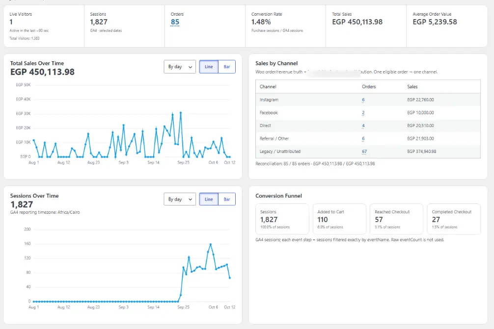
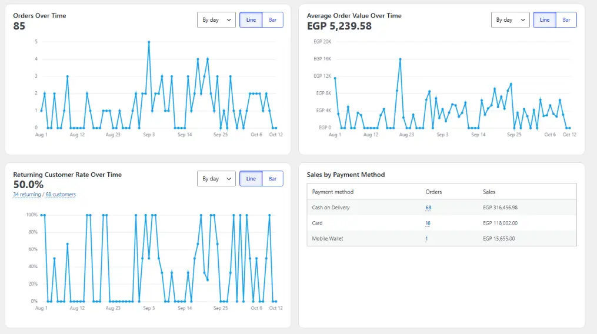
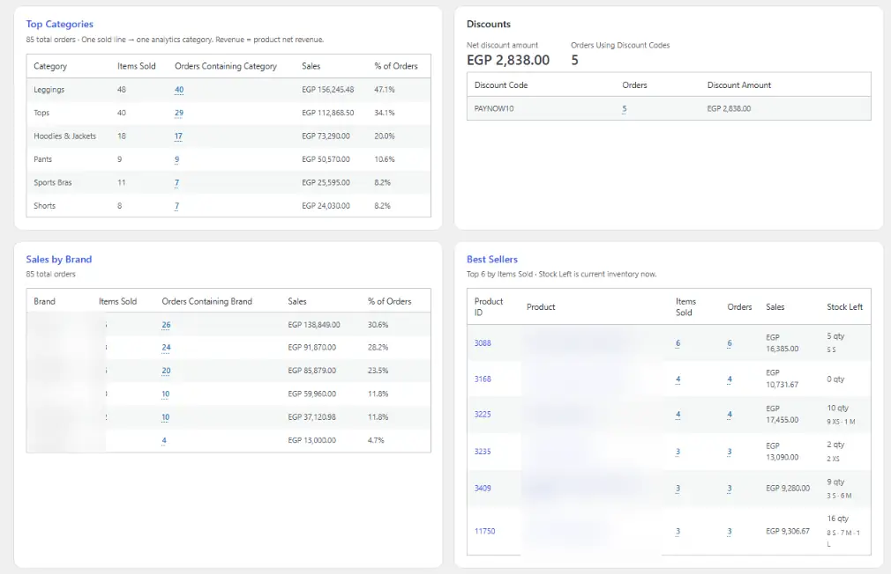
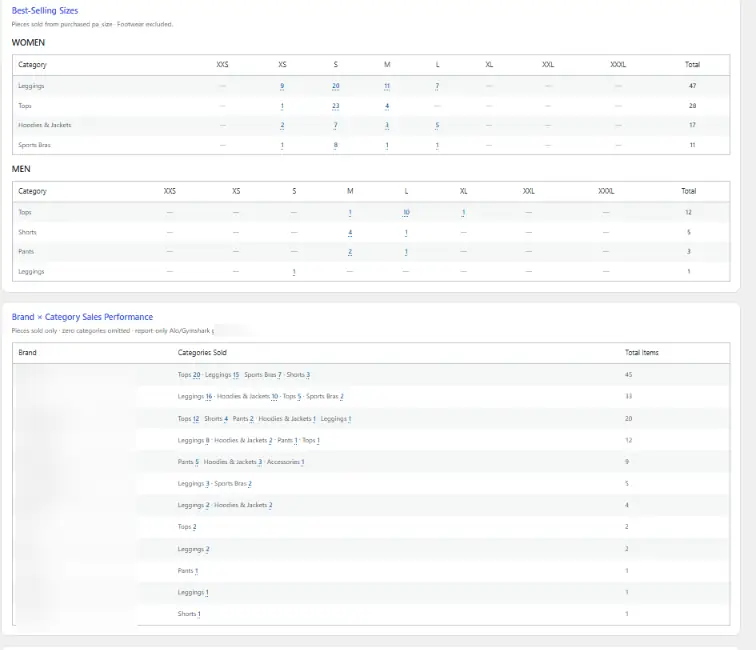
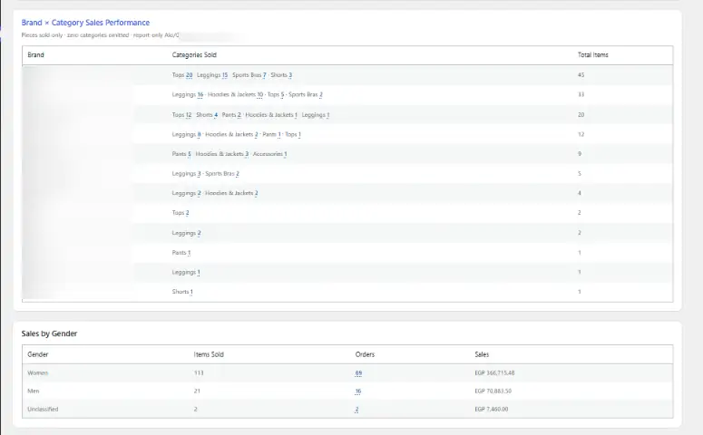

# WooCommerce Analytics Dashboard — AI-Assisted Portfolio Project

**A custom reporting workspace for a multi-brand, high-SKU WooCommerce store, designed after migrating from Shopify.**

This repository is a **sanitized portfolio edition** of a custom WordPress/WooCommerce analytics plugin developed iteratively in 2026. It demonstrates the implementation and the decision-making behind reconcilable financial KPIs, customer and merchandising reports, GA4 traffic analysis, and safe admin drill-downs. Operational credentials and customer-level records are not included. Public screenshots retain historical aggregate financial figures with names blurred.

> **Release status:** historical production source version 0.5.3; public copy has a deliberate host-configuration change and is **not independently regression-tested or production-certified**. It is not a turnkey universal plugin: classification IDs, acquisition boundaries, and some reports are specific to the original store. Do not install it on a live store without adapting and testing it.

## The real business problem

After migrating the e-commerce store from **Shopify to WordPress/WooCommerce**, the team needed the familiar, easy-to-read analytics experience they had relied on before. WooCommerce's built-in reporting did not provide the same combination of dashboard usability and *store-specific* breakdowns needed for this business. Because the catalog includes **multiple sportswear brands and thousands of product SKUs and variations**, the standard aggregates were not sufficient for buying, merchandising, stock-planning and marketing decisions.

The request became a **Shopify-inspired but WooCommerce-native analytics dashboard** with a unified date range and tailored sales views: performance by category, brand, gender, best-selling product, purchased size and brand × category; returning customers; payment methods; discount usage; and conversion context. The project also joined **WooCommerce financial truth** to traffic and engagement data via **Google Analytics 4 (GA4)** and the **Google Cloud-hosted GA4 Data API**. It shows traffic sessions and visitors, checkout funnel metrics and a separate first-party live-visitor indicator. These are different data sources and are never represented as identical to WooCommerce orders.

The main engineering challenge was **trustworthy reporting**, not only attractive charts: we investigated inflated totals from excluded/trashed orders, reconciled revenue across reports, designed explicit catalog classification rules, and differentiated GA4 sessions from event counts. The dashboard is **read-oriented** and does not adjust stock, order status, payments or fulfillment.

## Historical dashboard screenshots

These are **historical dashboard captures**, not a live demo. Brand and product names have been blurred for public portfolio presentation. All other figures remain as captured; amounts and dates are real historical business aggregates, not synthetic data. The images do not contain customer names, emails, phone numbers or addresses.

## Highlights

- WooCommerce-derived Total Sales, Net Sales, Orders, Average Order Value, customer retention, payment methods, discounts, product category, brand, gender, best sellers and sizes.
- GA4 Data API integration for sessions, visitors and session-based checkout funnel; live visitor presence is separately implemented.
- Admin date ranges, comparison series, chart grouping and chart-type switching, expandable reports, and read-only order drill-downs.
- Centralized order-status exclusion policy, HPOS-compatible order handling, and explicit reconciliation checks.
- Analytics-only product classification; never modifies inventory, orders, prices or checkout transactions.

## Verified historical staging baseline

**2026-08-01–2026-09-25** (v0.2.0): 63 eligible orders; EGP 326,080.48 Total Sales; EGP 322,580.48 Net Sales; 51 customers; 25 returning customers (49.0196%); 3 discounted orders (EGP 1,783.50). Payment totals reconciled to Total Sales; category, brand and gender revenue each reconciled to EGP 322,275.48 eligible product net revenue. These are **historical validation numbers**, not current performance or demo seed data.

## Structure

- `plugin/azula-analytics/`: sanitized v0.5.3 PHP, JavaScript, CSS implementation.
- `docs/`: architecture, feature matrix, milestones, debugging history, testing evidence, security, roadmap, installation.
- `HANDOVER_REPORT.md`: comprehensive handover and verification limitations.
- `PORTFOLIO.md`: contribution statement, LinkedIn copy and screenshot recommendations.

## Installation

See [INSTALLATION.md](INSTALLATION.md). The public copy intentionally requires `AZULA_ANALYTICS_ALLOWED_HOST` before initializing, and requires external GA4 service-account configuration. Store-specific taxonomy IDs and the attribution activation boundary require review. **Do not use real production credentials in this repository.**

## Engineering ownership and AI assistance

The project owner defined business requirements, reporting rules, edge cases, UI priorities, test scenarios and acceptance criteria; performed staging/live verification, reconciled output against WooCommerce, and directed debugging and releases. Implementation and code iteration were **AI-assisted**, with the owner responsible for decisions, validation and deployment. This is not represented as entirely hand-written solo code.

## Read next

[Architecture](docs/ARCHITECTURE.md) · [Features](docs/FEATURES.md) · [Development history](docs/DEVELOPMENT_HISTORY.md) · [Challenges](docs/CHALLENGES_AND_SOLUTIONS.md) · [Testing](docs/TESTING.md) · [Security](docs/SECURITY.md) · [Roadmap](docs/ROADMAP.md) · [Changelog](CHANGELOG.md)